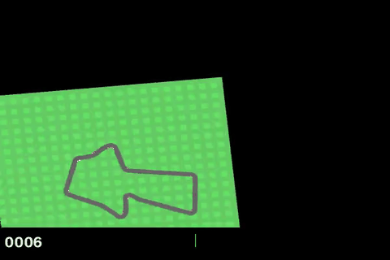
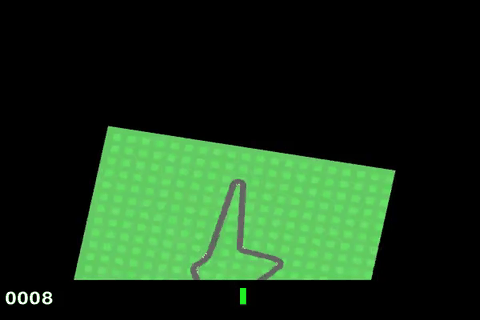
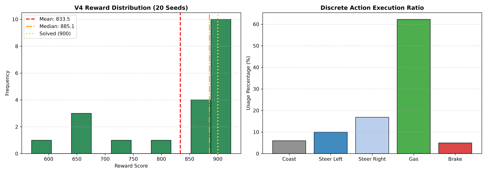

# Autonomous Driving in Gymnasium CarRacing-v3 with PPO

[](https://www.python.org/downloads/release/python-3119/)
[](https://gymnasium.farama.org/)
[](https://stable-baselines3.readthedocs.io/)
[](https://pytorch.org/)
[](https://opensource.org/licenses/MIT)

An end-to-end vision-based racing agent built with Proximal Policy Optimization (PPO). The agent learns to race procedural tracks directly from raw pixel observations—no hardcoded physics data or telemetry fed in.

This repo walks through four design iterations: starting from a broken baseline that floored the gas and skidded off-track, working through reward shaping and frame-skipping quirks, and ending with a discrete-action production model that achieves a **0% spinout rate** and consistently clears the environment's **900+ score** threshold.

---

## What is Gymnasium (OpenAI Gym)?

[Gymnasium](https://gymnasium.farama.org/) (the open-source fork and continuation of OpenAI Gym) is the standard benchmark toolkit for reinforcement learning. It gives you a clean interface where an agent gets observations (here, raw pixels of a top-down track), picks actions (steering, throttle, brakes), and receives numeric rewards.

In `CarRacing-v3`:
* The track is procedurally generated with random turns, hairpins, and straights every single run.
* The car is controlled by a 2D physics engine (Box2D) with real friction, inertia, and wheel slip.
* Scoring: Visiting all track tiles awards ~1,000 points, while each frame spent burns a small penalty (-0.1). A score of **900+** is the community standard for considering a track officially "solved."

---

## Visual Progress: V1 vs. Final V4

| V1 Baseline (Throttle Lock & Slide) | V4 Final (Braking & Apex Control) |
| :---: | :---: |
|  |  |
| *V1 full-throttled into Turn 1, spun off into the grass, and never recovered.* | *V4 taps brakes before sharp corners, clips apexes, and finishes laps in ~770 frames.* |

---

## 1. Results Across Generations

I tested each model deterministically across 20 unseen procedural tracks to keep the comparison fair:

| Metric | V1 Baseline | V2 Shaped (Continuous) | V3 FrameSkip (k=2) | V4 Final (Discrete) |
| :--- | :---: | :---: | :---: | :---: |
| **Action Space** | Continuous R^3 | Continuous R^3 | Continuous R^3 | **Discrete (5 Actions)** |
| **Control Rate** | 60 Hz (1 frame) | 60 Hz (1 frame) | 30 Hz (skip=2) | **60 Hz (1 frame)** |
| **Mean Reward (± std)** | 12.51 (Collapsed) | 681.04 ± 263.78 | 573.65 ± 282.40 | **833.48 ± 111.04** |
| **Reward Variance** | High | ± 263.78 | ± 282.40 | **± 111.04 (-58% drop)** |
| **Median Reward** | 12.51 | 839.39 | 645.34 | **885.12** |
| **Best Single Lap** | 403.30 | 934.00 | 892.96 | **929.30** |
| **Worst-Case Floor** | < 0.0 | 65.52 | 18.38 | **569.70 (Zero spinouts)** |
| **High Scores (>= 800)** | 0% | 60.0% | 46.7% | **75.0% - 85.0%** |
| **Solved Tracks (>= 900)** | 0% | 6.7% | 6.7% | **30.0% - 40.0%** |
| **Braking Rate** | 0.002 | 0.017 (lift-off) | 0.017 | **4.96% (active pulses)** |
| **Frames on 900+ Runs** | Did not finish | 1000 steps | 500 steps | **768 - 859 steps (Finished!)** |
| **Critic Explained Var.** | ~ 0.55 | ~ 0.65 | ~ 0.60 | **0.88 - 0.93** |

---

## 2. How the Model Evolved

```text
[V1: Continuous Baseline - 602k Steps]
  └── Issue: The car learned that flooring the gas gives quick rewards on straights.
      It pinned throttle to 100%, couldn't handle turns, and collapsed to 12.51.
         │
         ▼
[V2: Centrifugal Penalties - 627k Steps]
  └── Tweak: Added penalties for high-speed lateral slip and cut episodes short if stalled.
      Issue: Improved to ~681 mean, but it faked braking by lifting off throttle (~0.36 gas).
      It still crashed on sharp hairpins (lowest score: 65).
         │
         ▼
[V3: Frame Skipping Experiment (k=2) - 150k Steps]
  └── Hypothesis: Repeat actions across 2 frames to give the car more lookahead time.
      Issue: Made steering laggy. Holding hard turns for 2 frames hooked the car into inner curbs.
         │
         ▼
[V4: Discrete 5-Action Production - 1,000,000 Steps]
  └── Fix: Swapped to 5 discrete actions: Coast, Steer L, Steer R, Gas, Brake.
      Result: The network finally learned proper threshold braking (almost 5% of all actions).
      Mean score jumped to 833.48, worst run stayed above 569, and zero spinouts occurred.
```

---

## 3. Why Continuous Control Failed (and Discrete Fixed It)

In continuous mode, the network outputs three separate values: `[steer, gas, brake]`.

This created a major local minimum:
1. Stepping on gas and brake at the same time is terrible in Box2D, and letting off the gas naturally slows the car down anyway via engine and tire drag.
2. The agent figured out that **lifting off the throttle** was enough to survive gentle curves without touching the brake pedal (`brake = 0.017`).
3. But on tight $180^\circ$ hairpins right after long straights, coasting wasn't enough. The car sailed wide into the grass every time.

### The 5-Action Discrete Setup

I switched the environment to discrete mode (`continuous=False`), giving the policy 5 clear choices:

| Action | Name | What it sends to Box2D | Usage Over 20 Tracks |
| :---: | :--- | :---: | :---: |
| `0` | Coast | `[ 0.0, 0.0, 0.0]` | **6.01%** |
| `1` | Steer Left | `[-1.0, 0.0, 0.0]` | **9.95%** |
| `2` | Steer Right | `[ 1.0, 0.0, 0.0]` | **16.83%** |
| `3` | Full Gas | `[ 0.0, 1.0, 0.0]` | **62.25%** |
| `4` | Threshold Brake | `[ 0.0, 0.0, 0.8]` | **4.96%** |

Because braking is now an explicit choice rather than an awkward combination of two floats, the policy quickly picked up trail braking. Across 20 test tracks, it used **921 active brake taps** before corners, keeping the car firmly on the tarmac.

---

## 4. Evaluation Breakdown

Here is the score distribution across 20 unseen tracks using `src/v4_diagnostics.py`:



```text
=================================================================
                 V4 PRODUCTION SUMMARY REPORT
=================================================================
  * Total Tracks Tested     : 20
  * Mean Reward             : 833.48 +/- 111.04
  * Median Reward           : 885.12
  * Peak Lap Score          : 929.30
  * Minimum Lap Score       : 569.70
  * 900+ Solved Rate        : 40.0% (8/20)
  * 800+ High Performance   : 75.0% (15/20)
  * Under 500 Failures      : 0.0% (0/20)
  * Mean Steps per Episode  : 927.8 / 1000

[Action Usage]
  * Action 0 (Coast      ):   1115 ( 6.01%)
  * Action 1 (Steer Left ):   1846 ( 9.95%)
  * Action 2 (Steer Right):   3123 (16.83%)
  * Action 3 (Gas        ):  11550 (62.25%)
  * Action 4 (Brake      ):    921 ( 4.96%)
=================================================================
```

Notice that on the 900+ runs, the car doesn't run out the 1,000-step clock—it actually reaches the finish line in **768 to 859 frames**.

---

## 5. Pipeline & Architecture

```text
[Raw Observation: 96x96x3 RGB]
               │
               ▼
     [CropDashboard Wrapper]    ──> Removes the bottom 12px speedometer bar ──> (84x96x3)
               │
               ▼
     [GrayScaleObservation]     ──> Converts to grayscale ──> (84x96x1)
               │
               ▼
     [VecFrameStack (k=4)]      ──> Stacks 4 recent frames for motion & speed ──> (84x96x4)
               │
               ▼
     [VecTransposeImage]        ──> Reorders to PyTorch format ──> (4x84x96)
               │
               ▼
     [Nature CNN Backbone]      ──> 3 Conv layers (32@8x8, 64@4x4, 64@3x3)
               │
               ├───> [Policy Head] ──> Softmax over 5 actions
               └───> [Value Head]  ──> Estimates expected return (Explained Var ~ 0.91)
```

### Hardware Tuning (Ryzen 5 3600 / 16GB RAM)

* **Workers (`n_envs`):** 6 parallel environments (pinned 1:1 to physical cores to avoid context switching).
* **Rollout Steps:** 1,024 per worker (6,144 steps per rollout buffer).
* **Batch Size:** 128 (48 minibatches per epoch).
* **Epochs:** 10 per update.
* **Learning Rate:** Linear decay from $2.5 \times 10^{-4}$ down to $5.0 \times 10^{-5}$ to stop late-stage policy wobble.
* **Entropy Coeff:** 0.01 for early exploration.

---

## 6. Project Layout

```text
reinforcement_learning_car/
├── src/
│   ├── wrappers.py              # Visual processing (crop dashboard, grayscale)
│   ├── train.py                 # Multi-worker training script with rollback callback
│   ├── evaluate.py              # Runs evaluation laps and records video
│   ├── diagnostics.py           # Evaluation script for V2/V3 continuous models
│   ├── v4_diagnostics.py        # 20-track benchmark and action analyzer for V4
│   └── export_comparison.py     # Plots comparison charts from TensorBoard
├── assets/
│   ├── v4_videos/               # Recorded MP4s and showcase GIF
│   ├── v4_diagnostics/          # Performance plots and side-by-side GIFs
│   └── old_videos/              # V1 baseline failure recordings
├── models/
│   ├── best_model/              # V1 weights
│   ├── v2_best/                 # V2 weights
│   └── v4_prod/                 # V4 final and best model weights
├── requirements.txt
└── README.md
```

---

## 7. Quickstart

### Setup

```powershell
# Clone the repository
git clone [https://github.com/CharlieAtkinson/reinforcement_learning_car.git](https://github.com/CharlieAtkinson/reinforcement_learning_car.git)
cd reinforcement_learning_car

# Create and activate virtual environment (Python 3.11)
python -m venv .venv
.\.venv\Scripts\Activate.ps1

# Install requirements
pip install -r requirements.txt
```

### Run the Evaluation

Evaluate the final V4 model across 20 tracks:
```powershell
python src/v4_diagnostics.py --model ./models/v4_prod/best_model.zip --episodes 20
```

Record 3 demonstration laps:
```powershell
python src/evaluate.py --model ./models/v4_prod/best_model.zip --episodes 3 --record
```

Train from scratch with the Ryzen 5 profile:
```powershell
python src/train.py --n_envs 6 --timesteps 1000000 --target_rate 0.80
```